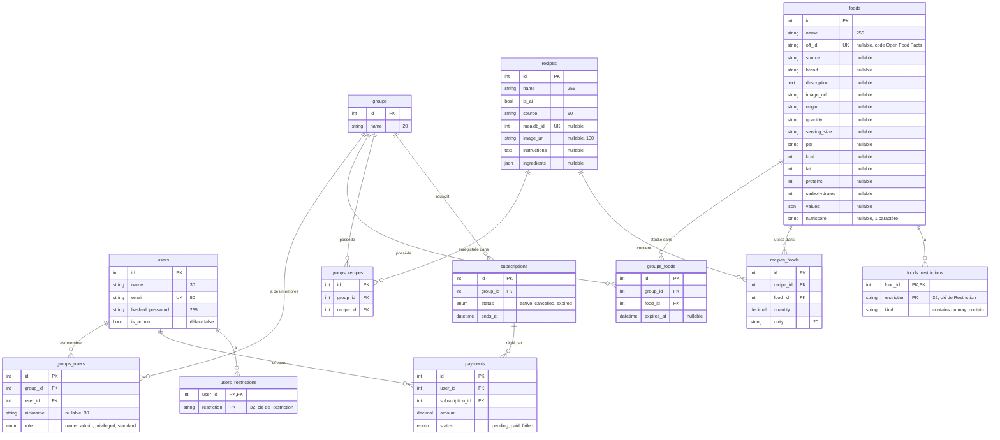

# Base de données

## Modèle de base

Toutes les tables héritent de `Base` (`src/touski/db/database.py`) et ont donc:

| Colonne | Type | Description |
|---|---|---|
| `created_at` | `DateTime`, non nul | Date de création, remplie à l'insertion |
| `updated_at` | `DateTime`, non nul | Date de dernière modification, mise à jour à chaque `UPDATE` via l'ORM |

## Diagramme

Les colonnes `created_at` et `updated_at` (voir plus haut) sont présentes sur toutes les tables et omises du diagramme.

## Tables

| Table | Rôle |
|---|---|
| `users` | Utilisateurs (nom, courriel unique, `is_admin`) |
| `groups` | Groupes d'utilisateurs (ex. un foyer) |
| `groups_users` | Membres d'un groupe, avec surnom et rôle (`owner`, `admin`, `privileged`, `standard`) |
| `foods` | Aliments (nom, valeurs nutritives en JSON) |
| `groups_foods` | Aliments d'un groupe, avec la date d'expiration `expires_at` (nullable) |
| `recipes` | Recettes (nom, `is_ai`, source) |
| `groups_recipes` | Recettes d'un groupe |
| `recipes_foods` | Ingrédients d'une recette (quantité et unité) |
| `subscriptions` | Abonnement d'un groupe (statut : `active`, `cancelled`, `expired`, et `ends_at`) |
| `payments` | Paiements d'un utilisateur pour un abonnement (montant, statut : `pending`, `paid`, `failed`) |
| `users_restrictions` | Restrictions (allergènes) d'un utilisateur: clé courte `restriction` (ex. `nuts`), clé primaire (`user_id`, `restriction`) |
| `foods_restrictions` | Allergènes d'un aliment: `restriction` et `kind` (`contains` ou `may_contain`), clé primaire (`food_id`, `restriction`) |

## Restrictions alimentaires

Les 14 allergènes réglementaires de l'UE sont codés en dur dans `src/touski/restrictions.py` (enum `Restriction`: `milk`, `eggs`, `gluten`, `peanuts`, `nuts`, `soybeans`, `fish`, `crustaceans`, `molluscs`, `celery`, `mustard`, `sesame`, `sulphites`, `lupin`). Il n'y a pas de table de référence: `users_restrictions` et `foods_restrictions` stockent la clé courte en `varchar`, validée par l'enum (API) et par le scraper.

Les tags Open Food Facts sont convertis par `parse_off_tag()` (insensible à la casse et aux accents, ignore le préfixe de langue, accepte des synonymes comme `en:sesame-seeds` ou `fr:lait`). Les tags inconnus sont ignorés.

Un aliment est sécuritaire pour un groupe si aucune des restrictions de ses membres n'y apparaît (voir `services/restriction_service.py`).
